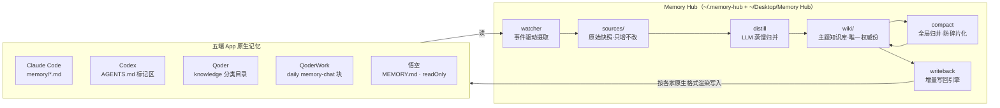

# Memory Hub 架构设计思路报告

> 版本：v1.0（2026-08-13）｜代码规模：约 11500 行 src + 219 个测试用例｜运行形态：macOS 本地 CLI + launchd 守护

---

## 1. 问题定义：AI 记忆孤岛

同时使用多个 AI 编程助手（Claude Code、Codex、Qoder、QoderWork、悟空）时，每家都有自己的记忆系统，但互不相通：

- 在 Claude Code 里教会的业务口径（如"转人工率分母用 xxx 字段"），换到 Qoder 里要重新解释一遍；
- 同一个坑（如 `robot_version` vs `agent_num`）在每个工具里各踩一次；
- 记忆散落在 5 处，没有一份可检索、可维护的全局知识库。

**Memory Hub 要解决的核心问题：让任何一端学到的知识，自动出现在所有端的原生记忆里。**

## 2. 核心设计理念：同步总线，而非中央图书馆

业界同类产品（如 basic-memory）的主流思路是"中央图书馆"——建一个新的统一记忆库，所有 AI 通过 MCP 协议在会话运行时来查。Memory Hub 选择了相反的路线：

| 维度 | 中央图书馆（MCP 拉模型） | **Memory Hub（同步总线，推模型）** |
| --- | --- | --- |
| 记忆积累 | 依赖模型"记得调工具存笔记" | watcher 事件驱动全自动采集，零纪律要求 |
| 记忆检索 | 每次会话调 MCP 工具（token+延迟） | 写回各 App **原生记忆位**，开会话即加载，零运行时成本 |
| App 接入 | 每个客户端配 MCP | 每个 App 写一个文件级适配器 |
| 非 MCP 应用 | 接不进 | 悟空/QoderWork 等封闭应用照样打通 |
| 一致性 | 单一真相源，无同步问题 | N+1 副本，同步是永恒战场（见 §5 可靠性工程） |

**取舍的本质**：用"适配器维护成本 + 同步复杂度"，换"零使用摩擦"。用户和模型都不需要改变任何习惯——这是个人基础设施（而非产品）场景下的最优解。

## 3. 总体架构

### 3.1 分层与数据流



### 3.2 模块职责

| 层 | 模块 | 职责 |
| --- | --- | --- |
| 采集 | `watcher.js` + `adapters/*` | FSEvents 监听 + 60s 轮询对账双保险；适配器负责"读懂"各家格式 |
| 存储 | `hub-store.js` | sources 快照（只增不改、hubId 全局唯一键）、hash-state 指纹对账、tombstone 登记 |
| 蒸馏 | `distill.js` | LLM 把快照归并为主题 wiki 页：语义去重、冲突双方保留、批次化调用 |
| 养护 | `compact.js` | 跨页面全局归并：主题键聚类 + LLM 分块重组，对抗知识库碎片化 |
| 写回 | `writeback.js` + `adapters/*` | wiki → 各家原生格式；增量契约、跨 App 并行、失败隔离 |
| 守护 | `daemon.js` | launchd 常驻：事件阈值触发 + 兜底扫描 + 启动追赶 |
| 观测 | `doctor.js` / `eval.js` / `search.js` | 健康体检、三层效果评测、全文检索 |

### 3.3 关键数据契约

- **hubId**（`hub-YYYYMMDDHHMMSS-xxxxxx`）：一条记忆的全局唯一身份，贯穿快照 → wiki 页 frontmatter → 各 App 写回体标记，是幂等、对账、删除传播的锚点；
- **`state/pending-writeback.json`**：distill/compact 与 writeback 之间的增量契约（`pages[]` 待写回 + `removals[]` 待清理），全部成功才原子清空，否则保留重试；
- **wiki 页 frontmatter**：`hub-id[]`（归并来源）、`category`（qoder 分类依赖）、`deleted`（tombstone 标记），使每页可幂等重放。

## 4. 关键设计决策记录（ADR）

### ADR-1：写回各家原生格式，而不是统一格式

每个适配器都实现 `render()`：Claude 双文件（条目 + MEMORY.md 索引行）、Codex AGENTS.md 标记区、Qoder 四字段 frontmatter 分类文件、QoderWork memory-chat 注释块。**代价**是 5 套渲染逻辑；**收益**是各 App 把写回内容当自家记忆加载，零运行时成本。这是整个系统的立身之本，不可妥协。

### ADR-2：LLM 蒸馏而非原文搬运

原始快照直接互相搬运会导致：重复内容爆炸、各家格式噪音互相污染、无全局视角。引入 LLM 蒸馏层（qwen3-max）做语义去重和主题归并，wiki 成为"被养护的知识库"而非"日志堆"。**代价**：token 成本（免费额度 200 次/天内运行）+ LLM 输出不可信（用 §5 的防御机制兜住）。

### ADR-3：wiki 是唯一权威份，App 侧副本可全量重建

所有 App 侧写回内容都可由 wiki 重新渲染生成（`hub writeback --full`）。任何一端副本损坏/丢失都不是灾难，恢复路径永远存在。反向不成立：wiki 只从 sources 蒸馏而来，sources 只增不改，构成"原始层 → 权威层 → 副本层"的单向可重建链。

### ADR-4：绝不信任 LLM 的标识符输出

LLM 只产出内容（标题/正文/标签），一切 **hubId 归属由代码计算**：distill 过滤编造 hubId（只认输入集合内的）、compact 的 hubIds 并集由代码按 sourceSlugs 映射计算、eval 探针 slug 必须来自输入。这条红线保证了对账体系不被幻觉污染。

### ADR-5：保守默认 + 显式放行的风险分级

- 写回按风险分批：batch1（claude/codex）自动 → batch2（qoder）自动 → batch3（qoderwork/wukong）默认禁用，`batch3Enabled` 显式开启；悟空因云端同步覆盖风险配置 `readOnly` 永不写回；
- 删除传播（tombstone）默认 `autoPropagate=false`：删除只登记证据链，`hub tombstone apply` 人工确认后才传播，并有风暴熔断（10 分钟 20 条阈值）防误删级联。

## 5. 可靠性工程：在别人的地盘写字

Memory Hub 最大的工程难点：**写回目标目录不归自己管**——App 客户端会重组目录、重写文件、云端同步覆盖。以下机制全部来自实战教训：

### 5.1 写入安全（safe-write.js）

```
备份（分池限额+1h 保护窗口）→ registerInflight → 原子写（tmp+rename）→ verify → 失败按 manifest 回滚
```

### 5.2 回环与回声的双层防御

这是系统最深刻的教训。写回的内容会触发文件事件，被自己重新采集：

- **第一层 inflight（路径+hash）**：写回前登记，watcher 命中即丢弃事件。**盲区**：App 重组目录（路径变了）或向同一文件追加（hash 变了）即绕过；
- **第二层回声护栏（内容指纹）**：`isEchoEntry` 按三类指纹拦截（正文 `[hub-…]` 渲染标记 / chatId `hub-` 前缀 / `source: memory-hub`）。实测该盲区曾造成"写回→采集→蒸馏→再写回"的回声循环，单日膨胀 1.3 万条快照、吹出 895 个重复 wiki 页。

**设计原则：凡是自己写出去的东西，必须能在任何变形后仍被认出来。** 渲染标记（hubId 水印）同时服务于幂等、校验、删除传播和回声识别，一个机制四处受益。

### 5.3 校验与回滚的粒度演进

- M8：写后 `verify()` 纳入生产管线，失败整批回滚；
- N2：校验口径与写入口径统一（qoder 跨 category 定位——Qoder 客户端会挪文件，只查预期目录必然误判）；
- N3：**条目级回滚**——verify 返回 `failedIds`，只回滚失败条目标 deferred 下轮重试，不连累整批（此前单条失败 → 整批回滚 → 935 页 pending 死循环）。

### 5.4 失败隔离与自愈

| 机制 | 防什么 |
| --- | --- |
| 毒批/毒簇隔离（失败 ≥3 次不再重放） | 一条坏数据反复烧 token |
| frontmatter 损坏 → `_quarantine` 物理隔离 | 单文件损坏阻塞全局扫描 |
| TooLarge 对半拆分、429/5xx 指数退避 | 网关限制导致整轮失败 |
| 跨进程文件锁（心跳 20s、3 分钟判陈旧） | daemon 与 CLI 并发互吞 |
| 每日写入配额（qoderwork 100 块/天） | 首次全量把目标 App 灌爆 |
| crash 计数 ≥5 主动 bootout | launchd KeepAlive 崩溃重启风暴 |

### 5.5 密钥纪律

明文密钥只存 macOS Keychain；配置只存引用名（`keyRef`）；日志/错误信息绝不回显 Authorization；蒸馏落盘前 `maskSecrets` 强制打码。仓库全历史扫描 0 密钥（L3 深度扫描多轮 0 发现）。

## 6. 演进史：每个机制背后的事故

| 事故 | 根因 | 沉淀的机制 |
| --- | --- | --- |
| qoder 写回死循环（pending 935 页永不清） | 客户端周期性重组记忆目录 + 校验口径与写入不一致 + 整批回滚连坐 | N2 跨 category 校验、N3 条目级回滚、备份保护窗口 |
| claude 通道 YAML 崩溃 | 正文以孤立 `---` 开头，gray-matter 字符串传参误判 frontmatter | 全部 `matter.stringify` 对象传参 `{ content }` |
| 同主题 wiki 页碎片化（ab-test 34 页） | LLM 起名随机性绕过词集相似度归并 | compact 全局归并（主题键聚类 + LLM 重组 + noGain 隔离） |
| 回声循环（单日 +1.3 万快照） | inflight 路径+hash 抑制被 App 重组/追加绕过 | 内容指纹回声护栏（采集层 + 蒸馏层双兜底） |
| qoderwork 隔天重灌 | 幂等只查当天 daily 文件 | 跨全部 daily 文件幂等 + 每日配额 |

**方法论**：每次事故 → 根因三层拆解 → 机制化修复 → 测试用例固化（194 → 219 个）→ 经验写回记忆系统本身。

## 7. 效果评测体系（hub eval）

"有没有用"拆成三层递进验证：

1. **管道有效性**（零成本，日志汇总）：写回成功率 99.3%（最近 2000 条，failed 0）、wiki 从 3162 页收敛中；
2. **记忆可达性**（确定性检测）：LLM 从 wiki 抽样出 20 道"只有记忆里才有答案"的事实探针题，判据关键词在各端记忆语料中的到达率——claude/codex/qoder 100%，qoderwork 90%（涓流回填中）；
3. **真实命中率**（人工盲测）：各 App 新会话问探针题，有/无记忆对照，净命中率 = 记忆的真实贡献。已实测案例：QoderWork 能引用写回的 daily 文件精确回答（`memory/2026-08-12.md#22-58`）。

收益换算模型：`净命中率 × 事实类提问频次 × 单次免重复解释时间 + 口径踩坑规避 × 单次返工成本`，对照成本（LLM 免费额度内 ≈ 0 元 + 维护时间）。

## 8. 已知边界与未来方向

**边界（清醒认知）**：
- 适配器是脆弱面：App 客户端升级改格式就要跟修（Qoder 重组行为已领教）；
- 检索是 grep 级：无语义检索、无知识图谱关系边（basic-memory 的强项）；
- 最终一致：分钟到小时级延迟，不适合会话内即时同步；
- LLM 蒸馏理论上存在改写失真，靠 prompt 约束 + 冲突双方保留缓解，无法根除。

**可能的下一步**：
- 语义检索：FastEmbed 向量 + SQLite（成熟方案可借鉴）；
- basic-memory 作为第六个适配器接入（它本质是"又一个 Markdown 记忆目录的 App"）；
- eval 第三层半自动化：LLM judge 判分盲测结果；
- wiki 页间关系边（wikilinks），让知识可遍历。

---

## 附：设计原则清单（供后续演进对照）

1. 零使用摩擦优先：用户和模型不改变任何习惯；
2. 单向可重建链：sources（只增）→ wiki（权威）→ App 副本（可全量重建）；
3. 自写内容必须可识别：hubId 水印贯穿一切写出物；
4. 不信任 LLM 的标识符，只信任它的内容；
5. 保守默认 + 显式放行：高风险操作永远需要人的一次确认；
6. 每个故障都要变成机制 + 测试，而不是一次性修复；
7. 一切写入可回滚，一切失败可重试，一切重试有上限。
