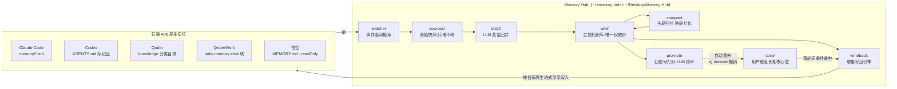

# Memory Hub 架构设计思路报告

> 版本：v2.0（2026-08-18）｜代码规模：约 13500 行 src + 241 个测试用例（22 个测试文件）｜运行形态：macOS 本地 CLI + launchd 守护
>
> v2.0 新增：用户维度长期核心层（§4）、daemon 运行时自证（§6.6）、LLM 预算刹车（§6.7），以及两次新事故的复盘（§7）。

---

## 1. 问题定义：AI 记忆孤岛

同时使用多个 AI 编程助手（Claude Code、Codex、Qoder、QoderWork、悟空）时，每家都有自己的记忆系统，但互不相通：

- 在 Claude Code 里教会的业务口径（如"转人工率分母用 xxx 字段"），换到 Qoder 里要重新解释一遍；
- 同一个坑（如 `robot_version` vs `agent_num`）在每个工具里各踩一次；
- 记忆散落在 5 处，没有一份可检索、可维护的全局知识库。

**Memory Hub 要解决的核心问题：让任何一端学到的知识，自动出现在所有端的原生记忆里。**

v2.0 补充了第二个问题：App 侧记忆是**会腐烂的**。实测 Qoder 整理机制对写回记忆的清理半衰期约 7.7 天——重要结论放着不管，两周后大概率消失。所以除了"打通"，还需要"让核心知识永不丢失"。

## 2. 核心设计理念：同步总线，而非中央图书馆

业界同类产品（如 basic-memory）的主流思路是"中央图书馆"——建一个新的统一记忆库，所有 AI 通过 MCP 协议在会话运行时来查。Memory Hub 选择了相反的路线：

| 维度 | 中央图书馆（MCP 拉模型） | **Memory Hub（同步总线，推模型）** |
| --- | --- | --- |
| 记忆积累 | 依赖模型"记得调工具存笔记" | watcher 事件驱动全自动采集，零纪律要求 |
| 记忆检索 | 每次会话调 MCP 工具（token+延迟） | 写回各 App **原生记忆位**，开会话即加载，零运行时成本 |
| App 接入 | 每个客户端配 MCP | 每个 App 写一个文件级适配器 |
| 非 MCP 应用 | 接不进 | 悟空/QoderWork 等封闭应用照样打通 |
| 一致性 | 单一真相源，无同步问题 | N+1 副本，同步是永恒战场（见 §6 可靠性工程） |

**取舍的本质**：用"适配器维护成本 + 同步复杂度"，换"零使用摩擦"。用户和模型都不需要改变任何习惯——这是个人基础设施（而非产品）场景下的最优解。

## 3. 总体架构

### 3.1 分层与数据流



### 3.2 记忆的三级提纯

v2.0 起，记忆不再是"快照 → 主题页"两级，而是三级金字塔，越往上越浓缩、越持久：

| 层 | 位置 | 维度 | 生命周期 | 写回策略 |
| --- | --- | --- | --- | --- |
| 原始层 | `sources/` | 会话快照 | 只增不改，永久留存 | 不写回 |
| 主题层 | `wiki/*.md` | 主题（2500+ 页） | compact 持续归并养护 | 增量写回，App 侧可被清理 |
| **核心层** | `core/` | **用户**（≤50 条） | 每轮重申，**被清即复活** | 无条件重申，对抗 App 清理 |

主题层回答"关于 X 我知道什么"；核心层回答"关于**这个用户**，任何 Agent 都必须知道什么"——固定页 `user.md`（用户画像）与 `soul.md`（协作原则）+ `facts/*.md` 事实页（已拍板口径、长期有效规范）。core/ 是顶层目录（与 wiki 平级）且**支持手动编辑**：用户直接改/新增 .md（无需 frontmatter），领养机制自动补发 hub-id/tier/category 后同步五端——人写的和机器晋升的共存一处。

### 3.3 模块职责

| 层 | 模块 | 职责 |
| --- | --- | --- |
| 采集 | `watcher.js` + `adapters/*` | FSEvents 监听 + 60s 轮询对账双保险；适配器负责"读懂"各家格式 |
| 存储 | `hub-store.js` / `core-store.js` | sources 快照（只增不改、hubId 全局唯一键）、hash-state 指纹对账、tombstone 登记；core 页存储契约 |
| 蒸馏 | `distill.js` | LLM 把快照归并为主题 wiki 页：语义去重、冲突双方保留、批次化调用 |
| 养护 | `compact.js` | 跨页面全局归并：主题键聚类 + LLM 分块重组，对抗知识库碎片化 |
| 晋升 | `promote.js` | 主题页 → 核心层的提名-确认管道（四信号打分，见 §4） |
| 写回 | `writeback.js` + `adapters/*` | wiki → 各家原生格式；增量契约、跨 App 并行、失败隔离、core 重申 |
| 守护 | `daemon.js` | launchd 常驻：事件阈值触发 + 兜底扫描 + 启动追赶 + 健康自证 |
| 治理 | `llm-usage.js` + 冷却刹车 | LLM 调用预算台账与主动限频（见 §6.7） |
| 观测 | `doctor.js` / `eval.js` / `search.js` | 健康体检（10 项）、三层效果评测、全文检索 |

### 3.4 关键数据契约

- **hubId**（`hub-YYYYMMDDHHMMSS-xxxxxx`）：一条记忆的全局唯一身份，贯穿快照 → wiki 页 frontmatter → 各 App 写回体标记，是幂等、对账、删除传播的锚点；core 页**新发号**，绝不与来源主题页共用（共用会导致同一 hubId 双渲染拉锯）；
- **`state/pending-writeback.json`**：distill/compact 与 writeback 之间的增量契约（`pages[]` 待写回 + `removals[]` 待清理），全部成功才原子清空，否则保留重试；
- **wiki 页 frontmatter**：`hub-id[]`（归并来源）、`category`（qoder 分类依赖）、`deleted`（tombstone 标记）；core 页额外有 `tier: core`、`promoted-from[]`、`promoted-at`，使每页可幂等重放。

## 4. 长期核心层：对抗记忆腐烂（v2.0 新增）

### 4.1 晋升管道：客观信号初筛 × LLM 语义终审（双重门槛自动晋升）

一条主题页凭什么进核心层？第一道门槛是四个独立客观信号打分（每项 1 分，缺省 ≥3 分才成为候选）：

| 信号 | 判据 | 回答的问题 |
| --- | --- | --- |
| crossSource | sources 覆盖 ≥2 个 App | 是不是跨工具都在用？ |
| survival | 留存快照首见 ≥15 天且从未被清 | 经受住时间考验了吗？ |
| probe | eval 探针题命中过该页 | 真的被会话用到过吗？ |
| decision | 命中拍板措辞（"已拍板/用户确认/最终口径"…） | 是不是人拍过板的结论？ |

第二道门槛是 **LLM 语义终审**（v2.1，取代人工 apply 把关——实践证明"把关人永远不在场的人工把关 = 管道永久堵塞"）：终审官对照既有 core 标题判重，逐候选输出 `verdict`（promote/reject/defer）+ `confidence` + `reason`，判定标准写进 prompt：长期有效且可反复复用→promote；一次性产物/时效性分析/重复→reject；拿不准→defer（宁缓勿错）。

自动晋升护栏（代码侧硬规则，不交给 LLM）：

- **no LLM, no auto**：冷却期/解析失败/启发式降级的提名无自动晋升资格，只留清单下轮再审；
- `verdict=promote 且 confidence ≥ 0.7`（`core.autoConfidence`）才执行；
- 每轮最多 3 条（`core.maxAutoPromotePerScan`，按 信号分×置信度 取最优），防一次灌爆稀缺容量；
- `verdict=reject` 记 30 天负样本抑制；容量上限 50 硬约束；
- 每次自动晋升落 daemon 日志（含标题与理由），`hub promote demote` 随时撤销；`core.autoPromote=false` 可回退人工把关。

**为什么双门槛**：客观信号防 LLM 幻觉（没有跨源/存活证据的内容再像样也进不了候选），LLM 终审防信号误判（四信号全中的"一次性分析报告"依然会被语义拦住）。核心层是"任何会话都会加载的内容"，错晋的代价是每次会话被污染，所以宁缓勿错、限额慢晋。

### 4.2 分级写回：重申与复活

- 增量写回轮次里，core 条目**无条件重申**（不在 pending 清单也写）：未被清 → N2 幂等 skipped（零成本）；被 App 清理 → 自动重建复活；
- 适配器按 hubId 水印定位而非文件名，实测 Qoder 把写回文件改名/重建后重申机制照样收敛、不拉锯；
- **手动编辑与领养（v2.1）**：core/ 提升为顶层目录后对用户开放编辑——新增/改写的 .md 缺契约 frontmatter 时，写回前自动领养（补发 hub-id/tier/category，正文原样保留、坏 YAML 容忍）；删页走 demote（直接删文件会被重申复活，这是设计行为）；
- `--core-only` 模式支持只刷核心层；留存快照（`scripts/qoder-retention-snapshot.js`）专项跟踪核心层重申覆盖率（预期 100%）与累计复活次数（复活频繁 = 与 App 整理机制拉锯，提示去面板手动确认提升成熟度）。

E2E 实测：删除 Qoder 侧核心页 → 下轮写回自动复活 → 第三轮幂等 skipped；核心条目（如"宽表三大指标最终口径"）已在新会话的记忆总览中稳定出现。

## 5. 关键设计决策记录（ADR）

### ADR-1：写回各家原生格式，而不是统一格式

每个适配器都实现 `render()`：Claude 双文件（条目 + MEMORY.md 索引行）、Codex AGENTS.md 标记区、Qoder 四字段 frontmatter 分类文件、QoderWork memory-chat 注释块。**代价**是 5 套渲染逻辑；**收益**是各 App 把写回内容当自家记忆加载，零运行时成本。这是整个系统的立身之本，不可妥协。

### ADR-2：LLM 蒸馏而非原文搬运

原始快照直接互相搬运会导致：重复内容爆炸、各家格式噪音互相污染、无全局视角。引入 LLM 蒸馏层做语义去重和主题归并，wiki 成为"被养护的知识库"而非"日志堆"。**代价**：token 成本（免费额度内运行，见 §6.7 预算治理）+ LLM 输出不可信（用 §6 的防御机制兜住）。**模型选型教训**：批量蒸馏必须用非推理模型（qwen3-max）——推理模型（bailian/glm-5.2）的思考链计入输出配额，大批次会烧穿 16384 上限导致 content 为空。

### ADR-3：wiki 是唯一权威份，App 侧副本可全量重建

所有 App 侧写回内容都可由 wiki 重新渲染生成（`hub writeback --full`）。任何一端副本损坏/丢失都不是灾难，恢复路径永远存在。反向不成立：wiki 只从 sources 蒸馏而来，sources 只增不改，构成"原始层 → 权威层 → 副本层"的单向可重建链。

### ADR-4：绝不信任 LLM 的标识符输出

LLM 只产出内容（标题/正文/标签），一切 **hubId 归属由代码计算**：distill 过滤编造 hubId（只认输入集合内的）、compact 的 hubIds 并集由代码按 sourceSlugs 映射计算、eval 探针 slug 必须来自输入。这条红线保证了对账体系不被幻觉污染。

### ADR-5：保守默认 + 显式放行的风险分级

- 写回按风险分批：batch1（claude/codex）自动 → batch2（qoder）自动 → batch3（qoderwork/wukong）默认禁用，`batch3Enabled` 显式开启；悟空因云端同步覆盖风险配置 `readOnly` 永不写回；
- 删除传播（tombstone）默认 `autoPropagate=false`：删除只登记证据链，`hub tombstone apply` 人工确认后才传播，并有风暴熔断（10 分钟 20 条阈值）防误删级联；
- 核心层晋升（v2.1 调整）：改为 LLM 终审自动晋升——人工把关只在日志里提示、把关人永远不在场，等于管道永久堵塞；风险用双重门槛 + 限额 + 可撤销（demote）兑换，而非不可达的人工确认（见 §4.1）。

### ADR-6：daemon 必须运行时自证，CLI 验证不算数（v2.0）

同一份代码在 CLI 短命进程和 launchd 常驻进程里是**两种运行时**：EBADF 事故（见 §7）证明 CLI 全绿时 daemon 可以已经坏了三天。因此 daemon 每轮 pipeline 把各环节结果落盘 `state/daemon-health.json`（prime 结果 / 各环节 ok+error / 最近 LLM 成功时间），doctor 据此设硬性红线：**存活超 2 小时无任何 LLM 成功轮次 → ❌**。验证必须发生在能力实际运行的上下文里。

### ADR-7：共享额度必须主动让位，而不是撞墙即停（v2.0）

免费网关额度（10 次/时、200 次/天，失败也计数）由 hub 与用户交互共享。仅有"撞限流后冷却"（被动刹车）会让 hub 每小时烧满额度、用户交互永远撞墙。v2.0 增加**预算刹车**（主动让位）：`llm-usage.js` 台账 + `config.llm.hourlyCallCap/dailyCallCap`（本机 8/150），超额抛 `rateLimited` 复用既有冷却机制（小时预算 → 暂停 1 小时；日预算 → 暂停到次日凌晨）。缺省 0 不启用；仅真实网关调用记账（mock fetch 不记，防单测污染台账）。

## 6. 可靠性工程：在别人的地盘写字

Memory Hub 最大的工程难点：**写回目标目录不归自己管**——App 客户端会重组目录、重写文件、云端同步覆盖。以下机制全部来自实战教训：

### 6.1 写入安全（safe-write.js）

```
备份（分池限额+1h 保护窗口）→ registerInflight → 原子写（tmp+rename）→ verify → 失败按 manifest 回滚
```

### 6.2 回环与回声的双层防御

这是系统最深刻的教训。写回的内容会触发文件事件，被自己重新采集：

- **第一层 inflight（路径+hash）**：写回前登记，watcher 命中即丢弃事件。**盲区**：App 重组目录（路径变了）或向同一文件追加（hash 变了）即绕过；
- **第二层回声护栏（内容指纹）**：`isEchoEntry` 按三类指纹拦截（正文 `[hub-…]` 渲染标记 / chatId `hub-` 前缀 / `source: memory-hub`）。实测该盲区曾造成"写回→采集→蒸馏→再写回"的回声循环，单日膨胀 1.3 万条快照、吹出 895 个重复 wiki 页；
- **第三盲区（v2.0 新发现）：自写的“旁侧产物”**——hub 写回 claude 时除条目文件外还追加 MEMORY.md 索引行，索引行本身无任何指纹，三条规则全部漏网（见 §7 索引行回声）。修法不是加第四条指纹，而是让导航元数据彻底退出摄取。
- **第四盲区（v2.1 实爆）：聚合文件的指数雪球**——codex AGENTS.md 是单一聚合文件，全量写回把 wiki 页正文（自带 H2）写进标记区；而 codex.parse 按全文 H2 切节，把区内每个 H2 都当“外部新记忆”重新摄取。雪球：写回全量 → poll 全量重摄取 → 蒸馏产新页 → 写回更多。实测单文件滚到 11MB/1.3 万 H2，单日 3.5 万份重复快照/464MB，daemon 事件循环被同步 IO 拖死 4 小时。另两个放大器：11MB 上的 chokidar 原子写事件丢失（inflight 永不命中）；巨文件同步读取占满主线程。修法四道防线：① parse 只摄取标记区外（雪球断根）②标记区硬上限 `maxRegionEntries`（core 永不淘汰，其余滚动）③ ingest 内容指纹去重（同 app 同 title+body 只落一份快照，结构性保底）④巨文件拒摄取（>2MB 跳过）。教训之二：JS `arr.slice(-0)` === 全量——配额为 0 时截断失效，首版修复因此无效。

**设计原则：凡是自己写出去的东西，必须能在任何变形后仍被认出来；聚合文件的“写出面”还必须有硬上限。** 渲染标记（hubId 水印）同时服务于幂等、校验、删除传播、回声识别和核心层复活定位，一个机制五处受益。

### 6.3 校验与回滚的粒度演进

- M8：写后 `verify()` 纳入生产管线，失败整批回滚；
- N2：校验口径与写入口径统一（qoder 跨 category 定位——Qoder 客户端会挪文件，只查预期目录必然误判）；
- N3：**条目级回滚**——verify 返回 `failedIds`，只回滚失败条目标 deferred 下轮重试，不连累整批（此前单条失败 → 整批回滚 → 935 页 pending 死循环）。

### 6.4 失败隔离与自愈

| 机制 | 防什么 |
| --- | --- |
| 毒批/毒簇隔离（失败 ≥3 次不再重放） | 一条坏数据反复烧 token |
| frontmatter 损坏 → `_quarantine` 物理隔离 | 单文件损坏阻塞全局扫描 |
| TooLarge 对半拆分、429/5xx 指数退避 | 网关限制导致整轮失败 |
| 跨进程文件锁（心跳 20s、3 分钟判陈旧） | daemon 与 CLI 并发互吞 |
| 每日写入配额（qoderwork 100 块/天） | 首次全量把目标 App 灌爆 |
| crash 计数 ≥5 主动 bootout | launchd KeepAlive 崩溃重启风暴 |

### 6.5 密钥纪律

明文密钥只存 macOS Keychain；配置只存引用名（`keyRef`）；日志/错误信息绝不回显 Authorization；蒸馏落盘前 `maskSecrets` 强制打码；**push 前固定动作**：本次 diff + 全历史扫描真实密钥与个人信息（仓库全历史 0 密钥）。

**launchd 特例（v2.0）**：daemon 常驻进程持有万级 watcher fd 后 `posix_spawn` 必现 EBADF，无法再调 `security` 读 Keychain。修法是启动时、watcher 拉起之前 `primeApiKeyCache()` 把密钥预热进进程内存（不落盘、不进环境变量），常驻期间零 spawn。副作用：daemon 运行期间切换 keyRef 需重启生效（错误信息已给出明确提示）。

### 6.6 运行时可观测性（v2.0）

事故复盘暴露的共性问题是**错误被吞、日志说谎**：`keychainExists` 曾把 spawn 失败吞成"条目不存在"，把排查引向歧路。v2.0 的修正：

- 底层错误透传：`execFileSync` 失败区分"命令退出非零"（有 status）与"spawn 本身失败"（透传 errno code），后者正是抓到 EBADF 的关键；
- daemon 健康档案（`state/daemon-health.json`）：启动预热结果 + 每轮各环节结果 + 最近 LLM 成功时间，由 daemon 自己写、doctor 来读；
- doctor 第 10 项检查（分级规则）：从未启用 → ✅；曾运行现停摆 → ⚠️；预热失败 / 存活超 2h 无 LLM 成功 → ❌；最近成功距今超 24h → ⚠️。

### 6.7 LLM 额度治理（v2.0）

三层刹车，从被动到主动：

1. **限流冷却**（被动）：撞 429/IRC-001 即整轮刹车，小时级限流冷却 60 分钟、日额度耗尽冷却到次日凌晨——失败调用照样计费，撞墙后继续发请求等于白烧；
2. **预算台账**（主动）：`state/llm-usage.json` 小时滚动窗 + 本地自然日双计数，超 `hourlyCallCap/dailyCallCap` 主动暂停，给同 AK 的交互使用留余量（本机：网关 10 次/时留 2、200 次/天留 50）；
3. **输出配额**：所有 LLM 调用显式 `max_tokens: 16384`（网关缺省偏小易截断；截断 JSON 有括号栈修复兜底）。

## 7. 演进史：每个机制背后的事故

| 事故 | 根因 | 沉淀的机制 |
| --- | --- | --- |
| qoder 写回死循环（pending 935 页永不清） | 客户端周期性重组记忆目录 + 校验口径与写入不一致 + 整批回滚连坐 | N2 跨 category 校验、N3 条目级回滚、备份保护窗口 |
| claude 通道 YAML 崩溃 | 正文以孤立 `---` 开头，gray-matter 字符串传参误判 frontmatter | 全部 `matter.stringify` 对象传参 `{ content }` |
| 同主题 wiki 页碎片化（ab-test 34 页） | LLM 起名随机性绕过词集相似度归并 | compact 全局归并（主题键聚类 + LLM 重组 + noGain 隔离） |
| 回声循环（单日 +1.3 万快照） | inflight 路径+hash 抑制被 App 重组/追加绕过 | 内容指纹回声护栏（采集层 + 蒸馏层双兜底） |
| qoderwork 隔天重灌 | 幂等只查当天 daily 文件 | 跨全部 daily 文件幂等 + 每日配额 |
| **daemon LLM 静默三天**（v2.0） | chokidar 4 无 fsevents 退化 kqueue、万级常开 fd → macOS 26 `posix_spawn` EBADF → 读 Keychain 失败被吞成"条目不存在"；CLI 上下文无法复现 | 密钥启动预热（零 spawn）、spawn 错误透传 errno、daemon 健康档案 + doctor 硬性红线（ADR-6） |
| **幻影计费**（v2.0） | 单测 mock 调用把预算台账记进真实 state，每跑一次测试凭空 +20 次 | 记账默认仅真实 fetch 生效，测预算逻辑需显式 `budgetEnabled: true` |
| **索引行回声**（v2.0，回声第三盲区） | claude 适配器把 MEMORY.md 索引行解析成独立条目；hub 写回追加的索引行无任何回声指纹，每次重写触发整文件重新摄取 → 累计 1.8 万条索引回声快照（claude 源占比 99.7%），兼为 wiki 168 组重复标题的主因 | 索引行不再摄取（导航元数据非记忆本体，条目由条目文件单独摄取）；存量回声快照归档出扫描路径 |
| **响应体挂起冻结**（v2.0） | 超时定时器在拿到响应头即被清除，`resp.json()` 读体无任何超时保护；实测连接中途死掉（TCP 已 CLOSED）时永久挂起，daemon pipeline 整条冻结 | M9：body 读取纳入总超时预算（剩余时间竞速 + abort 兜底，超时抛 retryable），不依赖 fetch 实现对 signal 的响应 |

**方法论**：每次事故 → 根因三层拆解 → 机制化修复 → 测试用例固化（194 → 219 → 241 个）→ 经验写回记忆系统本身。

## 8. 效果评测体系（hub eval + 留存监测）

"有没有用"拆成三层递进验证：

1. **管道有效性**（零成本，日志汇总）：写回成功率 99.3%（最近 2000 条，failed 0）、wiki 2500+ 页由 compact 持续收敛；
2. **记忆可达性**（确定性检测）：LLM 从 wiki 抽样出 20 道"只有记忆里才有答案"的事实探针题，判据关键词在各端记忆语料中的到达率——claude/codex/qoder 100%，qoderwork 90%（涓流回填中）；
3. **真实命中率**（人工盲测）：各 App 新会话问探针题，有/无记忆对照，净命中率 = 记忆的真实贡献。已实测：核心层条目在新会话记忆总览中稳定出现并被正确归类。

v2.0 增加**留存维度**：`qoder-retention-snapshot.js` 定期快照 App 侧存量，量化清理半衰期（实测 ≈7.7 天）与核心层重申效果（覆盖 6/6、复活即恢复）——这正是核心层存在必要性的数据证明。

收益换算模型：`净命中率 × 事实类提问频次 × 单次免重复解释时间 + 口径踩坑规避 × 单次返工成本`，对照成本（LLM 免费额度内 ≈ 0 元 + 维护时间）。

## 9. 已知边界与未来方向

**边界（清醒认知）**：
- 适配器是脆弱面：App 客户端升级改格式就要跟修（Qoder 重组行为已领教）；
- 检索是 grep 级：无语义检索、无知识图谱关系边（basic-memory 的强项）；
- 最终一致：分钟到小时级延迟，不适合会话内即时同步；
- LLM 蒸馏理论上存在改写失真，靠 prompt 约束 + 冲突双方保留缓解，无法根除；
- 免费额度限速决定积压消化节奏（预算内约 8 批/小时），大积压需 1-2 天摊销；
- watcher 万级 fd 是结构性负担：预热缓存绕开了 Keychain 问题，但 chokidar 4 的 kqueue 模式本身值得换成 Node 原生 `fs.watch(recursive)`（FSEvents，每根目录 1 个 fd）。

**可能的下一步**：
- watcher 降 fd：迁移到原生递归 fs.watch，根治 EBADF 类风险；
- 语义检索：FastEmbed 向量 + SQLite（成熟方案可借鉴）；
- basic-memory 作为第六个适配器接入（它本质是"又一个 Markdown 记忆目录的 App"）；
- eval 第三层半自动化：LLM judge 判分盲测结果；
- wiki 页间关系边（wikilinks），让知识可遍历；
- 核心层 Phase 2：晋升信号引入"被引用频次"（写回后的真实召回统计）。

---

## 附：设计原则清单（供后续演进对照）

1. 零使用摩擦优先：用户和模型不改变任何习惯；
2. 单向可重建链：sources（只增）→ wiki（权威）→ core（精华）→ App 副本（可全量重建）；
3. 自写内容必须可识别：hubId 水印贯穿一切写出物；
4. 不信任 LLM 的标识符，只信任它的内容；
5. 保守默认 + 显式放行：高风险操作（batch3、删除传播、核心层晋升）永远需要人的一次确认；
6. 每个故障都要变成机制 + 测试，而不是一次性修复；
7. 一切写入可回滚，一切失败可重试，一切重试有上限；
8. 验证必须发生在真实运行时上下文：CLI 全绿不代表 daemon 健康，常驻进程要能自证（v2.0）；
9. 错误禁止被吞：底层失败原因必须透传到日志可见处，"说谎的日志"比没有日志更危险（v2.0）；
10. 共享资源主动让位：额度、配额类资源按预算自我约束，不把上游限流当作唯一刹车（v2.0）。
